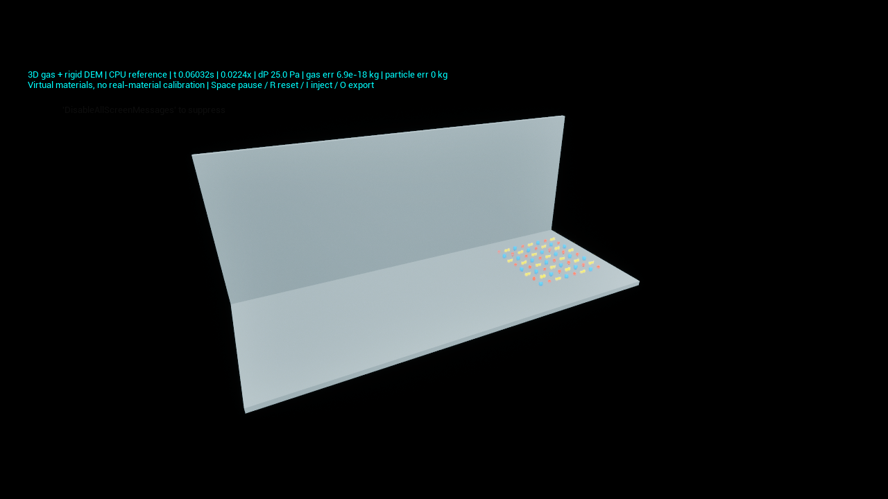

# 공기–분말 최소 연성 구현 및 검증 현황

2026-10-29. **소규모 CPU 최소 기능 통합·검증 완료. 전체 공정용 제품 완성/실험 검증 아님.** CPU 기준 경로와 GPU 입자–CPU 가스 연성 경로를 구현했다. 최신 우선순위는 기능·물리적 일관성·통합 검증이며 0.1배속 미달 자체는 완료 차단 조건이 아니다. 산업 공정 정확도 또는 실제 약품 물성 검증을 의미하지 않는다. 기존 GPU 혼합기와 저장 설정을 새 경로로 교체하지 않았다.

## 사용자 실행 통합 경로

최신 실행법과 원문 요구 대응은 [사용자 통합 실험 검증](사용자_통합실험_검증.md)에 정리했다. `L_CoupledPowder_Transport`와 `L_CoupledPowder_Filter`는 비구형 강체·공기 양방향 연성·접촉 인력·생성/배출 장부를 같은 CPU 해석기에 연결한 별도 기본형 실험이다. 기존 GPU 5만 개 경로의 기능을 모두 확장한 것으로 해석하지 않는다. GPU 비구형/동적 공급·배출은 대량화 후속 항목이며, 소규모 CPU 기능 검증과 구분한다.

## 최신 후속 결과

이 절이 아래 초기 CPU 단계 기록보다 최신이다. 초기 수치는 당시 구현의 이력으로 남긴다.

- `L_CoupledPowder_GPU50k`: 같은 50,000개, A 8,403개/B 41,597개, 총 약 40.838 kg. 가스와 입자 경계가 일치하는 기본 상자. CPU 가스와 GPU 입자를 매 물리 스텝마다 양방향 연결한다. 기본 응집은 꺼져 있으며 원본 혼합기 레벨을 교체하지 않는다.
- GPU 접촉 인력: 입자 쌍 `4πγR_eff`, 벽 `4πγr`, 접촉 허용오차 반경의 1e-5. 반발은 기존 PBD 근사라 **완전한 Hertz–DMT가 아니다**. 가상 gamma 두 값은 Reset 후 적용한다. 실제 재료별 인력표 및 분리 에너지 검증 없음.
- GPU 인력 경로의 위치 보정량을 별도 누적하여 float 위치 반올림에 따른 운동량 오류를 줄였다. 쌍 잔차 약 -2.62e-14 kg·m/s. 벽 하중 유지/이탈, 공기 힘에 의한 이탈, 가스 반작용에서 접촉 하중 제외, 이웃 후보 재사용 전후 위치/속도 일치 시험 통과.
- CPU 비구형 강체의 공기 전단에 의한 초기 회전력과 강체 간격, 반복 공급/양방향 배출의 질량 및 ID 재사용 거부 시험 통과. 출구 근처에서 수행한 경계 검사이며 전체 이송 공정 검증은 아니다.
- 단일 1 mm 가상 입자: 퇴적/부착 → 압력 구동 이탈 → 10 mm 높이 포획 경계 도달 → 압력 제거 뒤 재부착 유지. dt 2e-7/1e-7 s 모두 통과, 무부착 대조는 다시 낙하. 전체 분말층이나 실제 필터 케이크 검증이 아니다. `CoupledResuspension05`, `CoupledResuspensionFine`, `CoupledResuspensionNoAdhesion` 결과 참조.
- GPU 경로의 비구형 강체와 동적 공급/제거는 **미구현**. CPU 구현의 검증을 GPU 완료로 대신 표시하지 않는다. 실제 입도 분포/접촉 물성 보정과 산업 실험 대조도 미완료.

| 실측 조건 | 물리 시간 | 물리 초/현실 초 | 평균 표시 FPS | 온도/전력 최대 |
|---|---:|---:|---:|---:|
| 같은 5만 개 + 양방향 공기, 상자, 응집 OFF, 목표 .1 | 30.0049 s | .0999995 | 29.95 (7,500 프레임) | 55°C / 67.09 W |
| 같은 5만 개 + 양방향 공기, 상자, 쌍/벽 gamma=.01, 캐시 개선 전 | 8.0044 s | .0561443 | 24.83 (450 프레임) | 52°C / 88.44 W |

최신 캐시 재사용 응집 실행: 동일 50,000개로 물리 4.008초, .0578417배속, 평균 24.65 FPS, 최고 51°C/86.61 W. 기능 검증은 통과했지만 속도 개선은 작으며 0.1배속 미달이다. 더 긴 이전 실행과 시간 범위가 달라 직접적인 개선율은 단정하지 않는다. `CoupledBoxCohesiveCached50kSolo` 참조. 병행 회귀 검사와 겹친 `Saved/CoupledBoxCohesiveCached50k`는 자체 중단하여 성능 근거에서 제외했다. 이후 단독 실행 결과만 사용했다.

최신 회귀 18/18, UE 1039 빌드 통과. CPU 전단 회전/반복 유출 검사는 후속 보강 후에도 재실행 통과했다. `latest_tests.log`, `latest_cpu_function_tests.log`, `ue1039_build.log` 참조.

30 FPS는 상한 설정이고 반드시 달성된다는 뜻이 아니다. 첫 실행 5초 창 속도 최저 .099951, 평균 프레임 기준 p95 38.03 ms. 두 실행 모두 최종 50,000개 및 그룹 수 보존, 비유한값 없음, 닫힌 상자 벽 잔차 약 1.67e-8 m로 float 반올림 수준. 장시간 모든 조건의 안정성 보장 또는 입자 간 겹침 전체 검증을 뜻하지 않는다. 세부 결과는 각 `CoupledBox.../summary.json`, `audit.json` 참조. 가스 보고 시간이 최종 입자 시간보다 한 번의 게시 간격만큼 다른 초기 로그는 그대로 보존했다. 이후 종료 시 보고서 갱신을 보완했다.

공극률은 스텝 시작 입자 위치에서 매핑하여 다음 스텝에 사용하는 명시적 지연이 있다. 격자·시간 수렴과 적용 범위를 추가 확인해야 한다. 0.1배속 확보를 이유로 비구형/부착/보존 기능을 빼지 않는다.

## 실행

에디터 재시작 후 `Content/DEM/Tests/L_CoupledPowder_Minimum`을 연다. 새 클래스는 빌드된 모듈을 재시작하여 로드해야 한다. 기존 열린 에디터는 종료하지 않았다.

- Play: 64개 가상 강체, 기본 압력차 25 Pa, 293.15 K, 5 µs 물리 간격.
- Space 정지/재개, R 설정 재적용, I 8개 추가 공급, O CSV/JSON 저장.
- 압력차·목표 속도는 실행 중 변경 가능. 입자 수·입도 배율·밀도·응집·벽 부착·온도·유동 축·장애물은 R로 재초기화.
- 기본 입도 3/4 mm 구와 2구 강체 이물, 밀도 900/1500/2400 kg/m³. 모두 가상값.
- 표시만 10배 확대. 계산은 SI 단위. 메시는 계산 위치를 표시하며 재생 영상이 아니다.
- 설정 또는 안정성 제한 위반 시 오류를 표시하고 정지. 공급 위치에 기존 입자가 겹쳐도 정지하므로 공간 확보 후 재설정 필요.

## 구현과 검증 경계

| 요구 | 연결된 구현 | 이번 근거 / 남은 범위 |
|---|---|---|
| 공기 압력·유동 | 3D 등온 압축성 유한체적, 질량/운동량, 점성, 압력 경계 | 정지 균일압력·압력 구동·이미 흐르는 유동의 압력 반전·추가 압력 포트 질량 장부 통과 |
| 양방향 입자 영향 | 공극률 부피 매핑, 항력·압력 힘·토크와 반대 가스 반작용 | 8개 및 조밀한 512개 보존 시험 통과 |
| 입도·밀도·비구형 | 실제 계산 반경/질량과 비중첩 구 묶음 강체 | 상승 속도 차이 시험. 연속 PSD 입력 UI와 실측 보정은 미완성 |
| 응집·벽 부착 | 기존 접촉 시 인력/마찰/굴림저항 경로 | 기존 응집 유지/분리 시험, 새 연성 벽 부착 유지·무부착 이탈 시험 통과 |
| 역류·재부유 | 중력과 유동 항력을 함께 적분 | 압력 반전 및 상승 시작 통과. 퇴적층 전체 재부유→필터 재부착의 장시간 연쇄 시험 미완료 |
| 차단/퇴적 | 가스 고체 마스크와 DEM 상자를 동일 영역에 생성 | 완전 차단과 입자 벽 충돌 통과. 부분 장애물 설정 제공. 곡관/분진 케이크 동적 폐색의 정량 검증 미완료 |
| 공급·배출 | 고유 ID 재사용 거부, 공급/배출 질량 장부 | 추가/출구/중복 거부 통과. 출구는 강체 중심 통과 시 전량 제거하는 근사 |
| 온도 | 지정 등온 온도에 따른 EOS 밀도·Sutherland 점도 | 온도 변화 시험 통과. 열전달·증발·습윤·화학 반응 없음 |
| 육안 관찰 | Unreal 별도 스레드 계산 및 위치 스냅샷 표시 | NullRHI 실제 레벨 실행 통과. 렌더 실행 0.10016 s, 약 0.02275배속, 실패 없음. preview.png에서 색 구분·강체 표시·실시간 HUD 확인 |
| 대량 분말 0.1배속 | 기존 GPU 경로 유지, CPU 기준 경로 별도 | 초기 CPU 경로는 느림. 최신 GPU 실측은 위 표 참조. 성능과 기능 완료를 분리 |

## 수치 모델과 제한

가스는 1차 Rusanov 형태의 면 플럭스와 등온 상태 방정식을 사용한다. 입자 부피와 힘은 같은 양의 CIC 가중치로 매핑한다. 입자는 가스 항력과 압력 기울기 힘을 받고 가스에는 반대 힘이 들어간다. 항력 계수는 공극률 0.8 미만 Ergun, 이상 Wen–Yu 관계를 사용한다. 접촉은 기존 ClumpWorld의 선형/Hertz, 마찰 이력, 굴림 및 접촉 인력을 사용한다. 기준 장면은 가상 연성 접촉 강성을 사용한다.

공극률 최소 0.35, 입자 직경 ≤ 격자 폭/2, 속도·Re·음향 CFL·점성 CFL·명시적 항력 강성 조건을 검사한다. 1차 수치 확산, 거친 격자와 경험적 항력, 구 묶음 형상 및 접촉 시에만 작용하는 응집이라는 제한이 있다. 경계 부근 매핑과 강체 중심 기반 배출은 근사다. ±90 kPa UI 범위는 입력 허용 범위이며 해당 압력 전 범위의 안정성을 검증했다는 뜻이 아니다. 참고 자료의 -25 kPa 조건을 실증한 것이 아니다.

공식 관계 참고: [OpenFOAM Ergun/Wen–Yu](https://cpp.openfoam.org/v10/ErgunWenYuDragForce_8C_source.html), [Wen–Yu](https://cpp.openfoam.org/v10/WenYuDragForce_8C_source.html). 외부 상용 해석기는 사용하지 않았다.

## 검사 결과

- CPU 접촉/응집/강체/움직이는 벽/혼합/워커/시간간격 + 새 연성: CTest 8/8 통과.
- 기존 GPU 후보/재사용/경계/전송/커널/재료 + 공기저항: CTest 9/9 통과.
- 새 연성 시험은 추가 압력 반전·추가 포트 검사를 넣은 뒤 재실행 통과.
- 음향파 해석해 대비 속도 RMS 오차: x방향 8/16/32셀에서 1.32786e-4 / 6.34904e-5 / 3.08716e-5 m/s.
- 연성 시간간격 5/2.5/1.25 µs에서 종단 vx: 0.99986237366755648 / 0.99986215380143306 / 0.99986204396465328 m/s. 차이가 감소하지만 산업 조건 정확도 보증은 아님.
- Unreal NullRHI: 0.020 s까지 진행, 64강체, 가스 질량 오차 -2.60e-18 kg, 입자 장부 오차 0, 교환 잔차 5.17e-26 N·s, 실패 없음.
- Unreal 모듈 1034 빌드 성공. 기존 사용 중인 에디터와 별도 프로세스로 시험.

## 성능 실측 (FPS와 구별)

| 경로 | 계산 입자 수 | 물리 시간 | 물리 초/현실 초 |
|---|---:|---:|---:|
| 새 CPU, 최적화 전 | 64강체 | 0.1 s | 0.012783 |
| 새 CPU, CIC 할당·셀 상태 접근 개선 후 | 64강체 | 0.1 s | 0.020409 |
| 새 CPU | 512강체 | 0.02 s | 0.002856 |
| 새 Unreal NullRHI | 64강체 | 0.02 s | 0.022780 |
| 기존 GPU, 동일 5만 개 입력 | 50,000 | 4.008 s | 0.206377 |

64개 최적화 전후의 출력 CSV는 동일했다(출력 정밀도 범위 비교). 512개는 물리 1초당 약 350초 계산에 해당한다. 짧은 측정이므로 장시간 안정 속도 보장이 아니며, 5만 개로 선형 외삽하지 않는다. 마지막 GPU 수치는 양방향 가스 계산을 포함하지 않는다.

512개 CPU 시간 구성: 가스 0.196 s, 입자–격자 힘 연결 3.272 s, DEM 2.123 s, 커밋/부피 재매핑 1.111 s. 이 구간 합 기준 각각 약 3/49/32/17%. 음향 CFL에 따른 작은 시간간격과 입자별 데이터 생성/매핑/강체 계산이 병목이다. 64개 약 1.6배 개선으로 전체 목표가 해결되지는 않는다.

## 다음 완료 조건

1. 퇴적층 이탈→재부유→재부착, 부분 차단과 곡관, 반복 공급/배출을 실제 연쇄 시나리오로 검사.
2. 실제 대상 입도/밀도/접촉값 또는 명시적 가상 범위 확정. 전수 입자/대표 입자의 적용 범위 분리.
3. 입자 속성·매핑 작업 공간 재사용, 강체 캐시 최적화 및 독립 결과 대조.
4. 양방향 가스와 입자 연결을 GPU 경로로 이식하거나 검증 가능한 준정상/저마하 가스 모델로 확장. 현재 CPU 참조 구현을 대량 공정의 완성품으로 간주하지 않음.
5. 동일 대량 입력의 실제 속도·장시간 질량 보존·벽 투과/비정상 속도·표시 FPS를 각각 기록. 성능 미달만으로 기능 완료를 막지 않되, 필수 기능과 안정성 미검증은 완료로 표시하지 않는다.

GPU 5만 개 회귀 실행 중 관측 최고 전력/온도: 118.89 W / 55.0 °C. 어댑터 전체 관측값이며 개별 프로세스 전력은 아니다.

