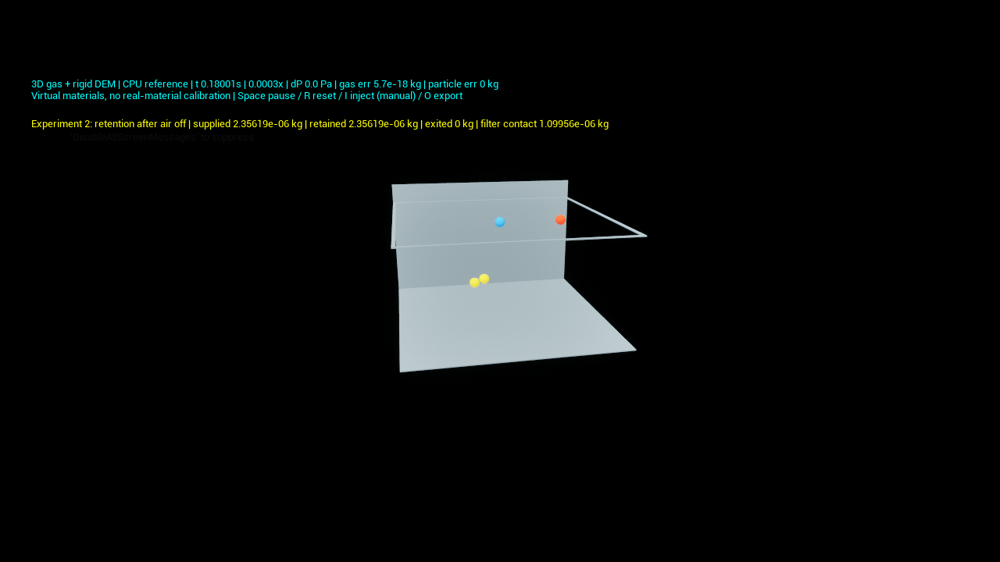

# 분체역학 사용자 통합 실험

2026-10-29. 기능 우선의 최소 구현 확인용이며 실제 약품/장비 보정 보고서가 아니다. 아래 CPU 실험은 기존 5만 개 GPU 혼합기를 변경하지 않는 별도 기본형 레벨이다. 소규모 통합 기능과 대량 성능을 구분한다.

## 실행 방법

에디터를 빌드된 모듈로 다시 열고 콘텐츠 브라우저의 `Content/DEM/Tests`에서 선택한다.

- `L_CoupledPowder_Transport`: 구형 두 종류와 실제 두 구 강체 이물을 초기 투입하고 물리 0.015 s에 두 번째 세트를 생성한다. 양방향 공기, 접촉 응집/마찰/회전, 중력, 실제 경계 배출과 질량 장부가 함께 작동한다.
- `L_CoupledPowder_Filter`: 세 강체를 바닥 부착 상태에서 시작해 공기로 이탈시키고, 정상 필터를 뜻하는 기체 통과·입자 차단 평면에 재부착시킨다. 압력 제거 후 잔류를 계산한다. 위로 올라갔다는 이유로 입자를 삭제하지 않는다. 모두 표면에 붙는 것을 강제하지 않는다. 형상/밀도/토크에 따라 일부는 재낙하할 수 있으며, 정상 필터가 막는 영역 밖으로 소실되지 않는지와 일부 입자의 지속 부착을 따로 검사한다.
- `L_CoupledPowder_Minimum`: 기존 수동 설정 실험. 입도 배율·밀도·접촉/벽 인력·온도·압력차·유동 축·부분 장애물을 조절할 수 있다. `Extra Pressure Face`는 추가 개구 면(-1=없음, 0/1=X-/+, 2/3=Y-/+, 4/5=Z-/+)이며 주 유동축과 달라야 한다. 추가 개구는 기체와 입자 모두 통과한다. `Extra Pressure Pa`는 절대압이다. 작은 실제 누설 구멍의 정량 모델은 아니다.

Play → Space 정지/재개, R 재설정, O 결과 저장. 기존 카메라 컨트롤러를 사용하므로 우클릭을 누른 채 WASD/QE로 이동하고 Shift로 가속할 수 있다. I 추가 공급은 수동 모드 전용이다. 실험 프리셋의 입자 수·물성·시간간격은 재현성을 위해 고정되며 수동 설정과 혼동하지 않도록 `Experiment` 설명에 표시했다. 계산 결과를 100배(프리셋) 또는 10배(수동) 확대 표시한다. 계산 단위는 SI이고 재생 영상이 아니다.

프리셋 액터의 `Experiment`를 바꾸고 R로 초기화:

| 값 | 실험 | 판정 핵심 |
|---:|---|---|
| 0 | 수동 설정 | 선택한 물성/압력/개구의 실제 계산 |
| 1 | 정상 이송 및 순차 공급 | 두 펄스 총 6강체, 공급=잔류+배출 |
| 2 | 재부유→필터 부착→압력 해제 | 영역 내 3강체 보존 및 압력 제거 후 표면 부착 질량 >0 |
| 3 | 완전 차단 | 반대쪽 출구 배출 0; 열린 입구 역류는 별도 기록 |
| 4 | 압력차 없는 대조 | 공급 뒤 중력/접촉 운동은 계속, 공압 이송 출구 배출 없음 |
| 5 | 벽 부착력 없는 필터 대조 | 필터 도달 뒤 압력 제거 시 재낙하 |
| 6 | 부분 차단 | 통과 가능한 영역으로 실제 접촉/유동을 계산하며 질량 보존 |

필터는 계산상 완전한 입자 차단 평면이다. 화면에는 내부 입자를 볼 수 있도록 테두리만 그린다. `filter contact mass`는 모델의 접촉 질량이지 실제 센서 측정값이나 필터 폐기량이 아니다. 출구/입구 이탈은 영역 경계 장부이며 외부 폐기나 제품 도착으로 자동 해석하지 않는다. 종류별 장부는 `protocol.json`의 `by_type`에 저장한다.

## 원문 요구사항 대조

| 요구 | 구현 경로 | 통합/수치 확인과 범위 |
|---|---|---|
| R1 입도·밀도·마찰·반발/회전 | CPU ClumpWorld 물성표, 수동 액터 | 서로 다른 밀도, 크기 조절, 기존 접촉/회전 회귀. 실제 분말 보정 없음 |
| R2 응집·벽 부착/이탈 | CPU 접촉 인력 + 공기/중력 | 필터 유지/무부착 재낙하 대조. 파쇄·소성·습윤 결합은 구현 아님 |
| R3 비구형 이물 | 실제 질량/관성의 비중첩 두 구 강체 | 공기 전단 회전, 강체 간격, 순차 이송/포획 통합. GPU 경로는 미지원 |
| R4 압력 유동·양방향 힘 교환 | CPU 3D 등온 가스 + 강체 | 동일 스텝 힘/반작용, 공극률, 경계 질량, 격자/시간 수렴 시험 |
| R5 압력 반전·개구·퇴적/차단/재비산 | 수동 압력/추가 개구 + 프리셋 2~6 | 반전·추가 포트 단위 검사, 완전/부분 차단 및 재부유/부착 사용자 실험. 실제 관 굽힘·필터 저항/동적 케이크 보정은 별도 |
| R6 공급/배출·잔류 운동 | CPU 실제 생성/제거, ID 및 종류별 질량 | 2회 순차 생성, 입구 역류와 출구 배출 분리. 출구는 강체 중심 기준 전량 제거 근사 |
| R7 혼합/회전 경계 접촉 | 기존 혼합/패들 해석 경로 보존 | 기존 혼합·움직이는 벽 회귀. 이번 기본형 이송 실험에 기계 모델을 추가하지 않음. 회전 날개의 기체 경계까지 푸는 이동 경계 CFD는 미구현 |
| R8 온도 | 등온 가스 EOS/점도 | 온도별 밀도/점도 검사. 입자 열전달·반응·증발은 범위 확정 전 미구현 |
| R9 계산 결과 관찰 | 새 두 레벨 + 기존 수동 레벨 | 실시간 위치·단계·공급/잔류/배출/필터 질량, 정지/재시작/내보내기 |
| 성능 | 별도 측정 | CPU 기능 통합은 느리며 기존 GPU 5만 개 기능/성능으로 대체 주장하지 않음 |

최소 입자 운동 기능의 사용자 실행 경로는 CPU 통합 실험으로 제공한다. 전체 공정 디지털 트윈, 모든 형상/운전 조건에서의 정량 정확도, 대량 GPU에서의 동일 기능 완료를 뜻하지 않는다. GPU 비구형/동적 공급·배출은 향후 대량화 항목으로 남지만 CPU 최소 기능 완료의 새로운 필수 조건으로 삼지 않는다.

## 수치 제한과 실패 처리

기본 프리셋 시간간격 1e-7 s. 다중 접촉 안정성 제한이 걸리면 그 시간 구간을 더 작은 스텝으로 나누어 같은 방정식을 다시 계산한다. 다른 오류를 숨기거나 시간·힘을 임의로 잘라내지 않는다. 최소 허용 재시도 간격은 1e-11 s이며 실패하면 정지한다. 사용한 최솟값은 `minimum_accepted_dt_s`에 저장한다.

구성 구 직경 1 mm, 이송 프리셋 kn=100 N/m, 필터 프리셋 kn=1000 N/m, cn=.003 N·s/m(이송), .02 N·s/m(필터), 접촉 인력 gamma=.002 J/m²(무부착 대조의 벽은 0). 밀도는 1000/1100/1200 kg/m³ 가상값. 이송/필터 충돌의 지나친 겹침을 줄이기 위해 가상 강성을 높였다. 초기 kn=10 N/m 필터 실행은 최대 겹침이 직경 약 10%여서 최종 품질 근거로 사용하지 않는다. 강성만 높이고 낮은 감쇠를 유지하면 충돌 후 튀어나와 포획되지 않았다. 필터 프리셋은 감쇠도 명시적으로 높인 가상 접촉 조건이며, 이 차이는 재료에 따른 포획 결과 차이를 보여준다. 구성 구 직경 5%를 넘는 겹침은 프리셋 실행 실패로 처리한다. 이 허용치는 산업 정확도 보증이 아니다.

가스는 1차 공간 근사와 경험적 고농도 항력식, 등온 가정, 직교 격자이다. 비구형 항력은 구성 구별 항력/토크 합산이며 형상 차폐·양력·난류·실제 섬유/필터 유동을 해석하지 않는다. 공극률 .35 미만은 모델 범위 밖으로 정지한다. 따라서 조밀 분말 케이크의 완전 막힘을 자동으로 정량 예측한다고 해석하지 않는다.

## 재현

- CLI: `Intermediate/PowderCore/Release/coupled_experiment.exe <새 출력 폴더> <1~6>`
- Unreal: `python Scripts/validate_coupled_experiments.py <새 출력 폴더> --mode <1~6>`; `--render`로 화면/스크린샷 확인.
- 두 실행은 `coupled_experiment`, `step_coupled_experiment` 공유 함수를 사용한다. 별도 애니메이션 구현이 아니다.
- 결과 파일: `result.json`, `protocol.json`(Unreal), 입자 CSV, CLI 시계열 CSV. 실험 초기 단계에서 시간간격/판정에 실패한 Saved 결과는 성공 근거에서 제외한다.

## 최종 실행 결과

정상 이송, 완전 차단, 부분 차단, 무유동, 부착 필터 및 무부착 필터 대조의 **6가지 Unreal 실행이 모두 통과했다**. 내보낸 구성 구 반경/종류로 잔류 질량을 독립 재구성하여 종류별 장부와 비교한 6가지 감사도 통과했다. 공급-배출 차이를 다시 비교하는 순환 검사만으로 판정하지 않았다.

| 실행 | 물리 시간 | 물리 초/현실 초 | 확인 결과 |
|---|---:|---:|---|
| IntegratedFinalTransport | .120213 s | .007209 | 6강체 순차 투입 후 전체 출구 배출, 종류별 장부 일치 |
| IntegratedFinalBlocked | .120032 s | .004915 | 반대편 출구 0, 입구 역류 1.256637e-6 kg를 별도 기록 |
| IntegratedFinalPartial | .120058 s | .006885 | 부분 차단 형상을 거쳐 전량 배출, 질량 장부 일치 |
| IntegratedFinalNoAir | .120106 s | .004725 | 6강체 영역 잔류, 출구 0 |
| IntegratedFilterFinalAccepted | .300006 s | .000355 | 세 강체 보존, 표면 부착 1.099557e-6 kg, 비구형 강체는 재낙하 |
| IntegratedNoAdhesionFinalAccepted | .300014 s | .000586 | 세 강체 모두 필터 도달 이력, 최종 표면 부착 0, 영역 질량 보존 |

필터 렌더 실행은 시작/종료를 포함해 약 858초가 걸렸다. 30 FPS는 표시 상한 설정이며 물리 배속과 다르다. 같은 접촉 조건 CLI 계산은 약 573초(.000524배속); 테스트 중 다른 로컬 작업이 병행된 관측값이고 고정 성능 보장이 아니다. 전체 공정용 성능으로 주장하지 않는다.

필터의 동일 조건 CLI 시계열에서 최대 겹침 1.373989e-5 m(직경 1.37%), 압력 해제 후 .2~.3 s의 201개 표본 모두 부착 질량 1.099557e-6 kg, 입자 질량 오차 0. 원래 CLI 판정은 모든 형상을 표면에 붙게 요구해 false였다. 그 과도한 판정을 모든 입자의 영역 보존과 양의 지속 부착으로 분리해 검토했다. 원본 결과를 수정하지 않고 `IntegratedFilterDampedRebuilt/current_contract_audit.json`에 판단 근거를 보존했다. 최종 Unreal 검증은 수정된 기능 계약으로 새 실행해 통과했다.

회귀 18/18 통과. 마지막 프리셋 물성 및 경계 검사 보강 뒤 해당 CPU 계약 시험을 재빌드·재실행해 통과했다. UE 1049 빌드 통과. 이 기록은 수치/실행 검증이며 실험 정확도 증명이 아니다.

## 포획 판정 변경의 근거와 감사

원문 [원료 투입 공정 기획 §6.2](D:/GitHub/가상현실게임/원료_투입_공정_디지털_트윈_기획정리.md:127)는 “분말 재비산·필터 부착 발생 가능”을 기술한다. 같은 문서 [157행](D:/GitHub/가상현실게임/원료_투입_공정_디지털_트윈_기획정리.md:157)은 정상 필터 안쪽 표면에 붙는 상태를 재현하고, 위로 움직였다는 이유로 소실시키지 않으며, 회수량/시간/폐기량을 구분하도록 요구한다. **모든 형상이 영구 부착해야 한다는 문구는 없다.** 따라서 다음을 별개로 검사한다.

1. 재부유와 필터 접촉이 실제 적분 궤적으로 발생한다.
2. 정상 입자 차단 경계에서는 영역 밖 소실이 없다.
3. 부착 조건에서는 압력 해제 후 양의 부착 질량이 지속된다.
4. 형상별로 재낙하할 수 있으며 이를 순간 삭제/외부 폐기로 세지 않는다.
5. 같은 크기·밀도·강성·감쇠·압력 일정에서 벽 gamma만 0으로 한 대조가 필터 도달 후 재낙하한다. 초기 바닥 평형 위치는 각 gamma 조건으로 재계산한다.

기존 `passed=false` 원본은 `IntegratedFilterDampedRebuilt/result.json`에 그대로 있다. “세 형상 모두 표면에 잔류”라는 기존 추가 판정이 실패한 사실을 지우지 않았다. `current_contract_audit.json`은 원문에 맞춘 계약 재검토이며, 이후 독립된 실제 Unreal 새 실행과 무부착 대조로 검증했다. 큰 겹침/이전 실행 파일이 사용된 예비 결과는 최종 성공 근거로 쓰지 않는다.

### 비구형 재낙하를 해석할 수 있는 수준

- 비구형 강체의 실제 관성·자세·접촉 레버암·각운동량이 계산되므로, 단순히 비구형 기능이 빠져서 떨어진 경우는 아니다.
- 실제 프리셋의 두 구 강체/물성으로 독립 해석식을 비교했다. 기울어진 한 점 접촉에서는 `Fz = 4πγr - kn·δ - mg`, `τy = -rx(4πγr-kn·δ)`와 계산이 일치하고, 대칭 두 점 접촉의 평형에서는 합력/토크가 0이 된다. 캐시 유무 및 dt=1e-9/5e-10 s에서 힘 잔차 약 5.01e-16 N, 토크 잔차 약 2.07e-19 N·m. `clump_force_torque_tests.log` 참조.
- 따라서 접촉 수/자세/관성 때문에 같은 입도와 부착 계수에서도 거동이 달라지는 것은 **현재 모델과 일관된 가능한 결과**이다. 전체 관측 궤적의 원인을 이 한 점 검사만으로 확정하거나, 구현에 결함이 전혀 없다는 증명으로 해석하지 않는다.
- 접촉 시에만 작용하는 인력, 비중첩 구 묶음, 구성 구별 항력은 근사다. 실제 JKR 분리 이력·유한 거리 부착·형상 차폐·습기/정전기는 포함하지 않는다. 형상별 포획률/재낙하 시간이 현실과 맞는지는 물성 측정과 전체 궤적 수렴/실험 대조가 필요하다. 현재는 **수치 일관성과 현상 구현 통과, 실험 정확도 미검증**으로 판정한다.

## 변경 범위

- `Physics/PowderCore/include/powder/coupled.hpp`, `src/coupled.cpp`: 공유 프리셋/시간 분할, 종류·면별 질량 장부, 닫힌 모서리 검사.
- `app/coupled_experiment.cpp`, `tests/coupled_tests.cpp`, CMake: 재현 실행/물리 검사/힘·토크 감사.
- `Source/VirtualGameTeamProj/PowderCoupledTest.h/.cpp`: 프리셋/개구 선택, 카메라 갱신, 상태/물성/종류별 내보내기.
- `Content/DEM/Tests/L_CoupledPowder_Transport.umap`, `L_CoupledPowder_Filter.umap`: 기본형 사용자 실행 레벨.
- `Scripts/create_coupled_experiment_levels.py`, `validate_coupled_experiments.py`, `audit_coupled_species.py`: 생성/실행/독립 질량 감사.

최종 GPU 온도/전력 관측 최대는 필터 렌더 검증에서 49°C/69.08 W였다. 기존 사용자 에디터는 종료하지 않았고 자체 검증 프로세스만 종료됐다. 새로운 모듈/속성을 쓰려면 에디터를 재시작한 뒤 위 레벨을 연다.
