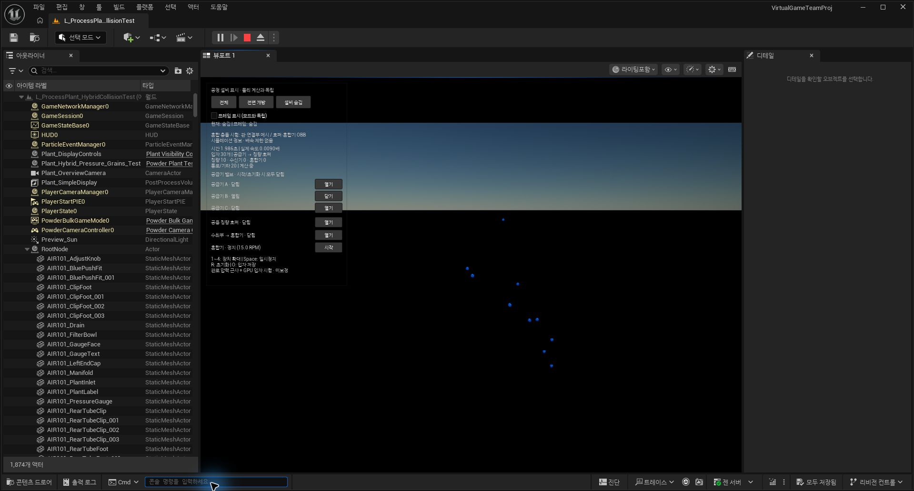

# 하이브리드 벽 검사 최적화 결과 — 2026-11-02

대상: `/Game/ProcessPlant_20261029/L_ProcessPlant_HybridCollisionTest`, 브랜치 `PowderSimulationOptimization`. 기존 레벨과 사용자 변경을 보존했다. 커밋/푸시 없음.

## 채택 / 기각

- 채택: 복잡한 평면 패치의 2D 외곽선 BVH. 최근접 선분 검색과 구멍 판정용 교차 검사를 함께 가속한다. 원본 선분 번호로 동률을 처리한다. 입자 반지름/벽 두께보다 먼 선분은 접촉에 영향을 줄 수 없을 때만 거리 검색에서 제외하며, 구멍 판정용 교차 검사는 유지한다.

- 기각: 실제 공간 순서로 재정렬한 형상 BVH. 빠르지만 86,700회 비교 중 41,028회가 1 µm 허용치를 넘었고 최대 위치 차이가 10.889 mm였다. 최종 데이터는 원래 접촉 순서를 유지한다. `--spatial`은 별도 출력 경로의 진단 실험만 허용한다.

- 기각: 구–AABB 거리로 더 강하게 가지치기하는 후보. 결과는 같았으나 현재 배관 구간 속도 개선이 없어 코드에 남기지 않았다.

- 보류: 시간 간격을 넘겨 벽 후보를 재사용하는 캐시. 접촉 보정 중 이동, 회전 로컬 좌표, 밸브 변경, 원래 순서에서 이미 지나간 가지를 처리하는 규칙까지 검증해야 한다. 안전한 갱신/재검사 조건을 구현·검증하지 않은 캐시를 추가하지 않았다.

## 동일조건 성능

RTX 4060 Ti, 30개(종별 10개), 반지름 2 mm, dt=10 µs, 접촉 반복 8회, 배치 16. 공급기 3개 개방/칭량 출구 닫힘. 컴퓨트 전용이며 렌더링 제외. 최적화 전 커널로 별도 기준 실행파일을 빌드해 비교했다. 새로운 커널의 느린 선형 호환 경로를 기준 속도로 쓰지 않았다.

각 구간 3,000스텝을 전후 교대로 3회 측정한 중간값:

| 구간 | 전 (sim s / wall s) | 후 | 해석 |
|---|---:|---:|---|
| 초기 0–0.03초 | 0.021907 | 0.021898 | 실질적인 전체 속도 향상 없음 |
| 공급 배관 체크포인트 이후 0.03초 | 0.005553 | 0.005575 | 실질적인 전체 속도 향상 없음 |

상판 주변 합성 접촉 부하: 같은 위치 30개 검사점, 5회 측정 중간값, 각 측정 12회 호출. 아래 시간은 GPU 경계 검사 커널만의 시간이며, 실제 해당 부품의 독점 시간이나 전체 공정 배속이 아니다.

| 검사 위치 | 전 µs | 후 µs | 배율 |
|---|---:|---:|---:|
| Collision_WH101_Separate_Top_Cover | 2070.4 | 234.3 | 8.84 |
| Collision_WH101_Inspection_Neck | 526.7 | 296.5 | 1.78 |
| P101B_WeighingFlexibleJoint | 548.7 | 215.7 | 2.54 |

단계 분리 프로파일링은 추가 커널 비용을 발생시키므로 위의 실제 통합 커널 속도와 구분한다:

| 구간/버전 | GPU 전체 단계 합 s | 벽 처리 s | 벽 비율 |
|---|---:|---:|---:|
| initial/baseline | 2.1483 | 1.6286 | 75.8% |
| initial/optimized | 2.1881 | 1.6687 | 76.3% |
| later/baseline | 6.3436 | 5.7297 | 90.3% |
| later/optimized | 6.3603 | 5.7481 | 90.4% |

## 회귀와 한계

- 14,450개 검사점 × 회전각 3개 × 경계/속도 셸 2종 = 86,700회: 기존 하이브리드 대비 위치·법선·벽 속도 차이 0. 구멍/선분 인접점, 관/연결부, 정지·회전 형상을 포함한다.
- 초기 및 배관 체크포인트에서 3,000스텝씩 전후 비교: 저장된 입자 위치·속도·종류 성분 차이 0.
- 원본/하이브리드 수동 밸브 회귀 통과. 회전 혼합기 30개, 15 RPM, 0.1초 검사 통과.
- 원래 삼각형 모델 대비 기존 하이브리드의 최대 5.623 mm 접촉 차이는 그대로 남아 있다. 이번 최적화의 차이 0은 현실 정확도 인증이 아니다.
- 전 구간 장시간 이송, 장시간 혼합/막힘, 실제 장비/물성 검증은 하지 않았다.
- UE Development 모듈 1072 빌드 성공. 기존 에디터를 정상 종료 후 하나만 다시 실행했다. `live.json`은 실제 PIE 설정 확인 기록이다.
- 이전의 `edge_*`, `sphere_*`, `spatial_*` 파일은 중간 실험이다. 최종 전후 수치는 `paired_summary.json`, `initial/later_baseline/optimized_*`, `final_*` 파일을 사용한다.

## 변경 파일

- `Scripts/build_plant_hybrid.py`: 선분 BVH 생성, 기준/실험 출력 옵션.
- `Physics/PowderCore/src/granular_plant_cl.inc`: 가속 검색과 안전한 거리 제한, 동률 순서 보존.
- `Physics/PowderCore/include/powder/plant.hpp`: 새 선분 트리 구조 검증.
- `SourceAssets/ProcessPlantHybrid/runtime.plant`, `runtime.routes`, `manifest.json`: 주소 재배치 포함 재생성. 형상·압력 조건·입자 수는 유지.
- CMake 및 `plant_hybrid_optimization_tests.cpp`: 접촉 위치/법선/속도 회귀.
- `Scripts/benchmark_hybrid_optimization.py`, `inspect_hybrid_live.py`: 전후 측정과 PIE 관찰.

## 재현

`build_plant_hybrid.py --output <별도폴더> --linear-edges`로 기준 데이터, 기본 실행으로 최종 데이터를 생성할 수 있다. 속도 기준 실행파일은 이번 작업 전 커널을 보존한 `Intermediate/HybridOptimization/baseline_kernel.inc`로 빌드한 `reference_bin`이다. 기준 소스/바이너리는 로컬 Intermediate 보관물이며 최종 제품에 포함하지 않는다. `benchmark_hybrid_optimization.py`는 기준 실행파일 존재를 요구한다.

## 에디터 관찰

모듈 1072로 실제 하이브리드 레벨을 실행했다. 총 30개, dt 10 µs, 반복 8회, 오류 없음. 공급기 B만 GUI로 열었고 파란 입자 10개가 칭량호퍼로 이동했다. 전후 스냅샷의 파란 입자 평균 위치는 약 (−0.00048, 1.39952, 2.23540) m → (−0.02923, 0.01406, 0.71294) m이다. GUI 칭량 입자 수 10, 전체 30을 확인했다. 입자를 보기 위해 렌더만 숨기고 카메라를 가까이 이동했으며 물리 설정은 변경하지 않았다. PIE의 누적 평균 속도 약 0.009배는 닫힌 밸브에서 기다린 시간을 포함하므로 벤치마크의 정상상태 속도로 해석하지 않는다. 검증 후 PIE를 종료했고 해당 레벨을 편집 상태로 남겼다.

