# 20261104 모델 이송 관찰 종료 보고

사용자 요청에 따라 장시간 회전 대기를 취소하고 물리 시간 **14.89007962384494초**에서 멈췄다. 이미 혼합기 단계에 도달한 뒤였다. 2026-11-06 16:31:38 KST 기록에서 동일 정지 시간이 처음 확인되었고, 16:32:36에 상태를 별도 저장했다. 이후 사진 촬영 내내 시간이 변하지 않았으며 16:44:53에 관찰 콜백까지 해제했다. 최초 Space 입력의 정확한 벽시계 시각은 별도 계측하지 않았으므로 위 시각은 기록으로 확인한 정지 시각이다.

## 시험 범위와 조건

- 레벨: `/Game/ProcessPlant_20261103/L_ProcessPlant_ParticleSetup`. 실제 자산/계산 데이터는 20261104 모델이다.
- A/B 각 10,000개, 합계 20,000개. C~F 0개. 반지름 2mm, 기존 물성, dt 1e-5초, 접촉 반복 8, 시험 압력차 1000Pa, 혼합기 15RPM 유지.
- 이번 관찰 중 코드·형상·물성 변경, 재시작, 리셋, 새 에디터 실행, 커밋/푸시 없음. 사진용 카메라 및 표시 모드만 바꿨다. 관찰 스크립트와 보고서만 추가했다.
- A 개방 0.10032초 → B 개방 0.80032초 → 칭량 출구 개방 1.50016초 → 수취 출구 개방 및 혼합기 시작 5.13904초.
- 수취부 영역 19,997개가 4.69072초에 확인됨. 이 중 수평관 입구의 1개는 기존 원통형 영역 카운터와 겹치므로 아래 실제 위치 분류에서는 수평관으로 분류했다.
- 혼합기 도달 19,837개는 7.55904초부터 종료까지 유지. 혼합기는 시작 후 약 9.75104 물리초(설정 RPM 기준 약 2.438회전) 관찰했다. 추가 회전 대기는 사용자 지시에 따라 취소했다.

## 최종 개수

| 실제 위치 | A 빨강 | B 파랑 | 합계 |
|---|---:|---:|---:|
| 혼합기 내부 | 9894 | 9943 | 19837 |
| 수취부 하단 출구 링 | 105 | 54 | 159 |
| 수취부 전 수평관 바닥 | 1 | 2 | 3 |
| WH101 원뿔 안쪽 | 0 | 1 | 1 |
| 합계 | 10000 | 10000 | 20000 |

최종 CSV에서 20,000개의 고유 ID와 유효한 좌표를 확인했다. 144개 시간 기록에서 총량은 모두 20,000개, 해석기 오류 문자열은 모두 비어 있었다. 19,837개(99.185%)가 혼합기에 도달했고 163개가 앞 구간에 남았다. 총량 보존만으로 모든 벽 관통 부재나 물리 정확도를 증명한 것은 아니다.

## 잔류와 기존 문제 재현

1. **수취부 출구 링 재현:** 이번에는 159개. 이전 모델의 170개를 그대로 가져온 결과가 아니다. 관찰된 잔류점은 `BV272_111_Ferrule_neck`의 z≈2.133m 수평 면 위로, 샘플 입자 중심과 표면 거리 약 2mm가 입자 반지름과 일치한다. 적어도 6.9592~14.8901초 약 7.93초간 CSV 정밀도에서 위치가 같았다.
2. **수평관 바닥 잔류 재현:** 이번에는 3개(ID7452,10437,11895). 4.4634~14.8901초 약 10.43초간 좌표가 같았다. 모두 `COLLISION_RH201_PowderPath_Static`의 z≈2.621m 바닥에서 중심 z=2.623m로 접촉한다. 이번 관찰은 항력·마찰력 항별 계측을 하지 않았으므로 정지 원인을 특정 힘 하나로 단정하지 않는다.
3. **추가 WH101 잔류:** 파랑 ID10590 한 개. 2.7757~14.8901초 약 12.11초간 좌표가 같았다. `Collision_WH101_Cone_ID700_to_44_final` OBB 표면과 중심 거리 약 2.004mm. 경사면 접촉 잔류이며 원인 수정은 하지 않았다.
4. **혼합기 날개 미접촉 재현:** 9.7874초 및 이후 관찰 표본에서 혼합기 입자 전부가 로터 회전 반경 밖이었다. 원본 로터의 X축 최대 회전 반경 0.264711m, 입자 반지름을 더한 접촉 가능 반경 0.266711m. 종료 시 입자 중심의 최소 축 거리 0.316325m로 약49.6mm 여유가 있다. 축 높이0.9m, 로터 최저점0.635289m, 바닥0.575m로 바닥 간격은 약60.3mm. 낙하 중 잠시 날개와 상호작용한 것과 가라앉은 입자층을 지속적으로 섞는 것은 구별해야 한다. 현재 충전량에서 지속 혼합은 확인되지 않았다.

위 시간은 저장된 관찰 표본에 근거한 보수적 지속 시간이다. CSV의 좌표 반올림 범위보다 작은 미세 움직임까지 0이라고 뜻하지 않는다. 다른 충전량/물성/압력, C~F 실제 다입자 이송, 장시간 혼합 품질, 계측값과의 물리 보정은 미검증이다.

## 최종 상태

- 같은 에디터/레벨/PIE를 유지하고 **시뮬레이션 Running=false + 에디터 툴바 PIE 일시정지** 상태로 보존.
- 재생성/리셋 없이 20,000개 상태 유지. 물리 시간 14.89007962384494초가 촬영 완료 후에도 동일.
- 전면 개방, 프레임 숨김, 전체 공정 시점으로 복원. 새 dirty map 없음.
- GUI의 혼합기 가동 요청(15RPM)은 설정으로 남아 있지만, 시뮬레이션과 PIE가 정지되어 회전/입자 계산은 진행하지 않는다.
- 자동 관찰 및 카메라 캡처 콜백 종료. 추가 시험을 수행하지 않는다.

## 사진 안내

### 그림 1. 공정 전체 맥락

오른쪽 큰 수취호퍼 아래의 원형 출구 링, 왼쪽 WH101 칭량호퍼, 두 호퍼 사이 상단 수평관을 비교한다.

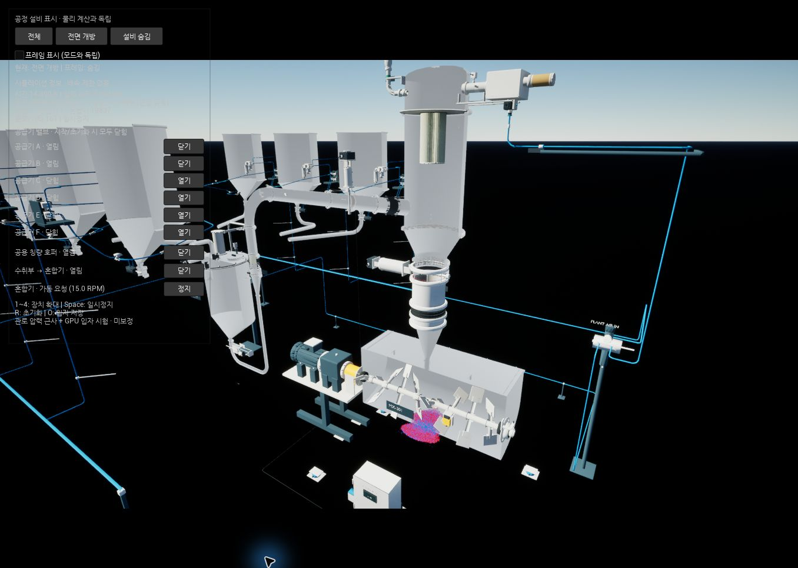

### 그림 2. 수취부 하단 출구 링 — 159개

수취호퍼 원뿔 아래, 밸브와 직관 연결부 사이의 좁은 원형 턱에 빨강 105개·파랑 54개가 둘레를 따라 남았다. 출구는 열린 상태다.

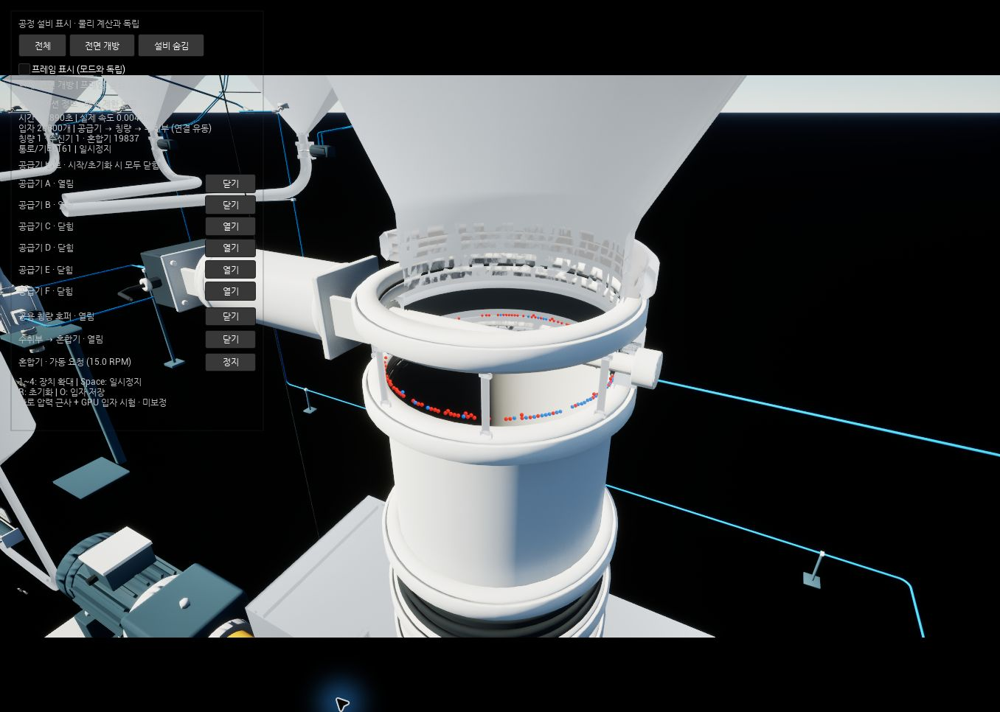

### 그림 3. 칭량호퍼 → 수취부 수평관 위치

왼쪽 WH101에서 올라온 관이 오른쪽 큰 수취호퍼에 들어가는 상단 수평 구간이다.

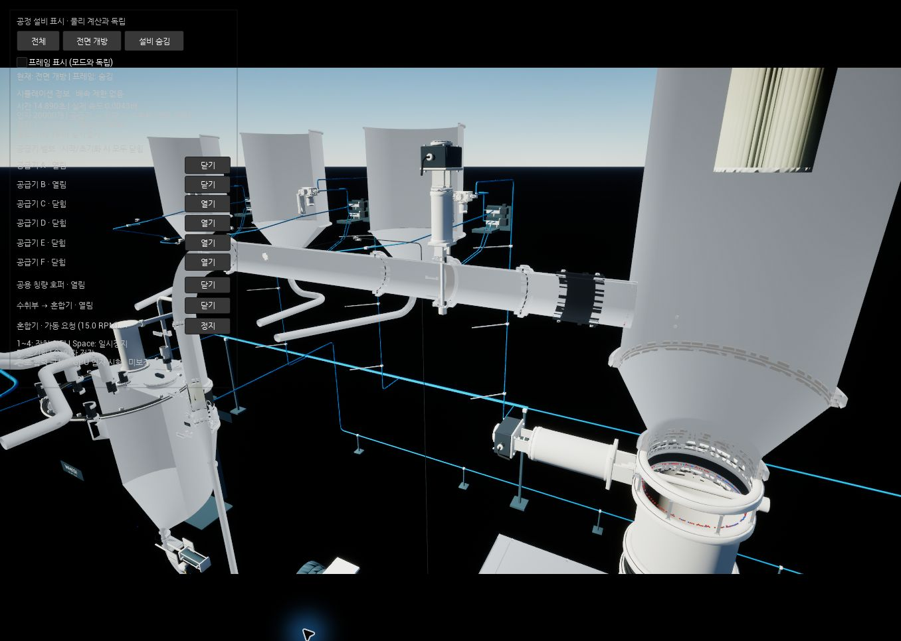

### 그림 4. 수평관의 세 잔류 위치

왼쪽 밸브 바로 오른쪽 바닥에 파랑, 검은 연결부 시작점 바닥에 파랑, 수취호퍼 입구 직전 바닥에 빨강이 있다. 그림 5~7에서 각각 확대했다.

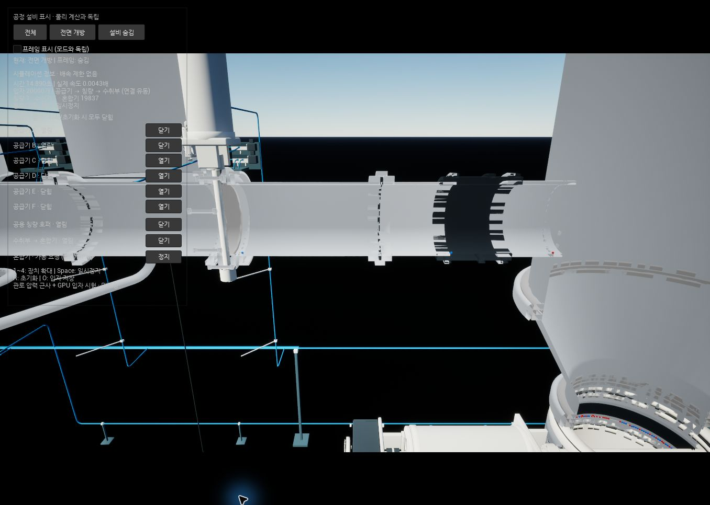

### 그림 5. 밸브 바로 오른쪽 — 파랑 1개

중앙 파란 입자 ID11895. 물리 좌표 (2.19984, -0.000004907, 2.623)m. 수평관 바닥과 접촉한다.

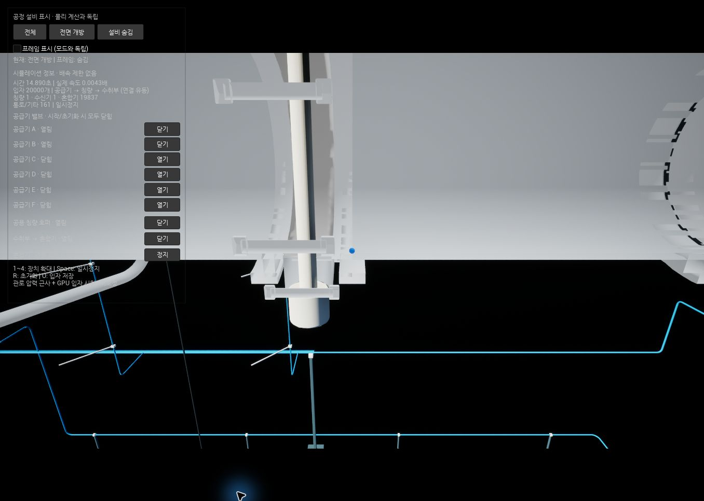

### 그림 6. 검은 연결부 시작점 — 파랑 1개

중앙 파란 입자 ID10437. 물리 좌표 (2.57118, -0.000023841, 2.623)m. 오른쪽 끝에 그림 7의 빨간 입자도 보인다.

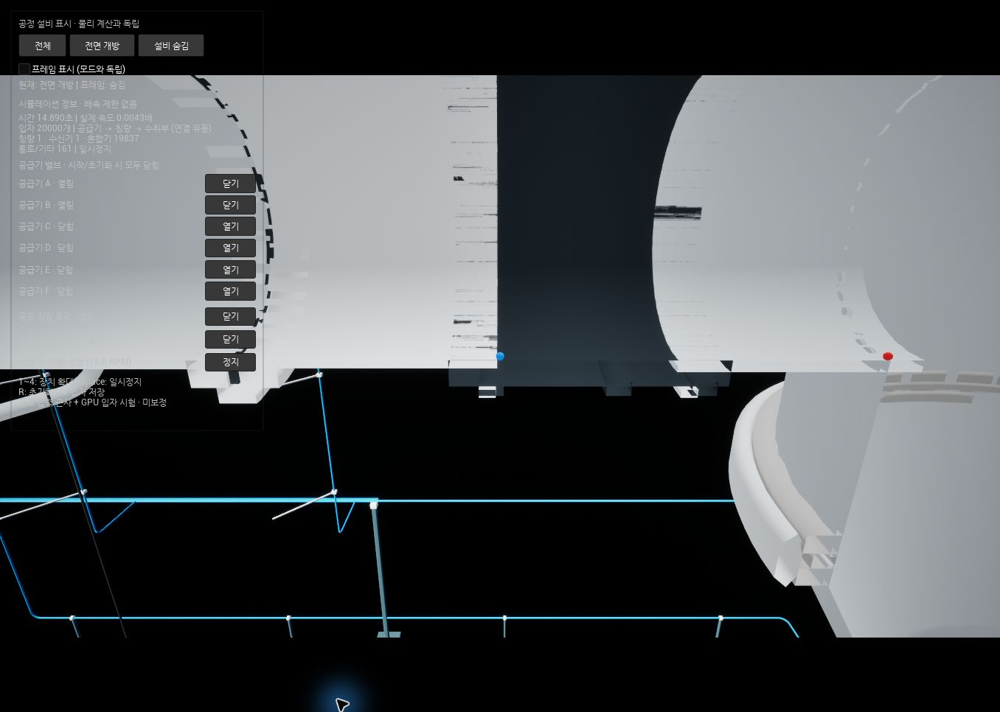

### 그림 7. 수취부 입구 직전 — 빨강 1개

중앙 빨간 입자 ID7452. 물리 좌표 (2.75203, -0.000014563, 2.623)m. 큰 수취호퍼 측벽으로 들어가기 직전의 관 바닥이다.

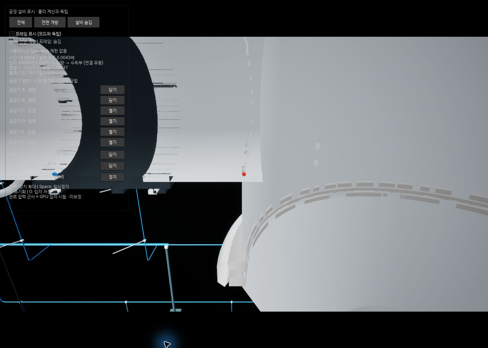

### 그림 8. WH101 칭량호퍼 전체 위치

하단 원뿔 안쪽에 파랑 1개가 남았다. 외부 전면 개방 화면에서는 해당 접촉면이 숨겨지므로 그림 9~10은 전체 표면을 표시한 내부 시점으로 촬영했다.

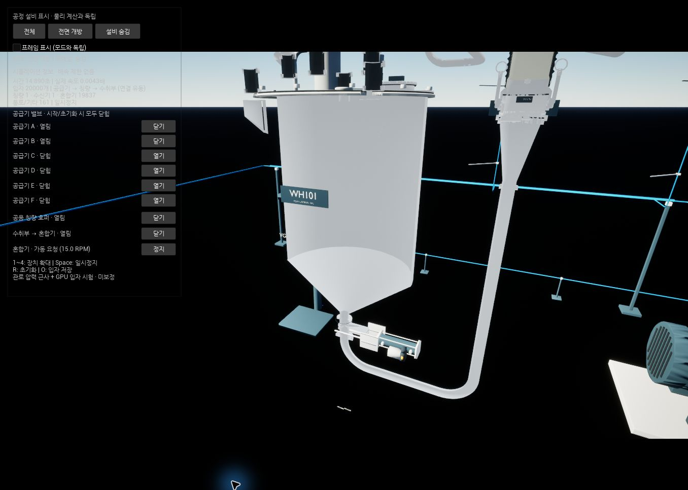

### 그림 9. 칭량호퍼 원뿔 안쪽 — 파랑 1개

중앙 파란 입자 ID10590. 물리 좌표 (-0.0783161, -0.096052, 0.780217)m. 아래쪽의 작은 구멍은 칭량호퍼 출구다. Unreal 좌표는 물리 좌표의 Y 부호가 반대이고 단위는 cm다.

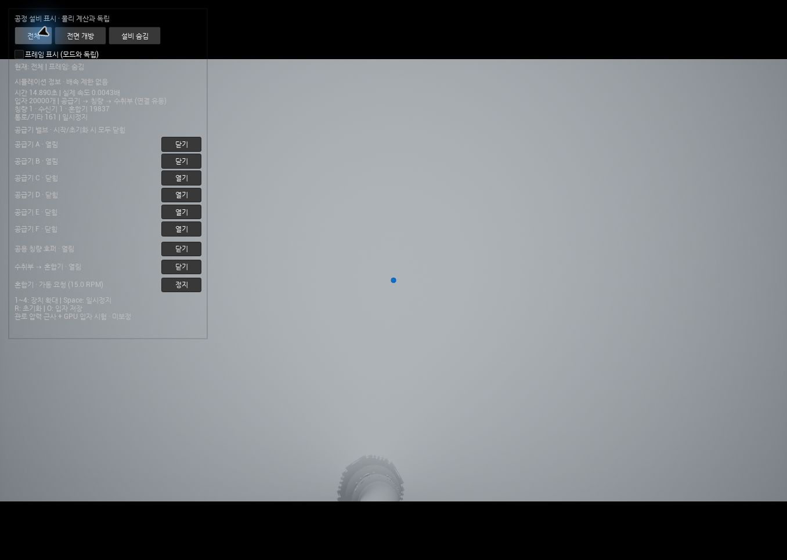

### 그림 10. 원뿔 내부에서 본 잔류 위치

중앙 아래 출구 구멍의 오른쪽 위 경사면에 작은 파란 입자가 보인다. 그림 9의 근접 사진과 같은 입자다.

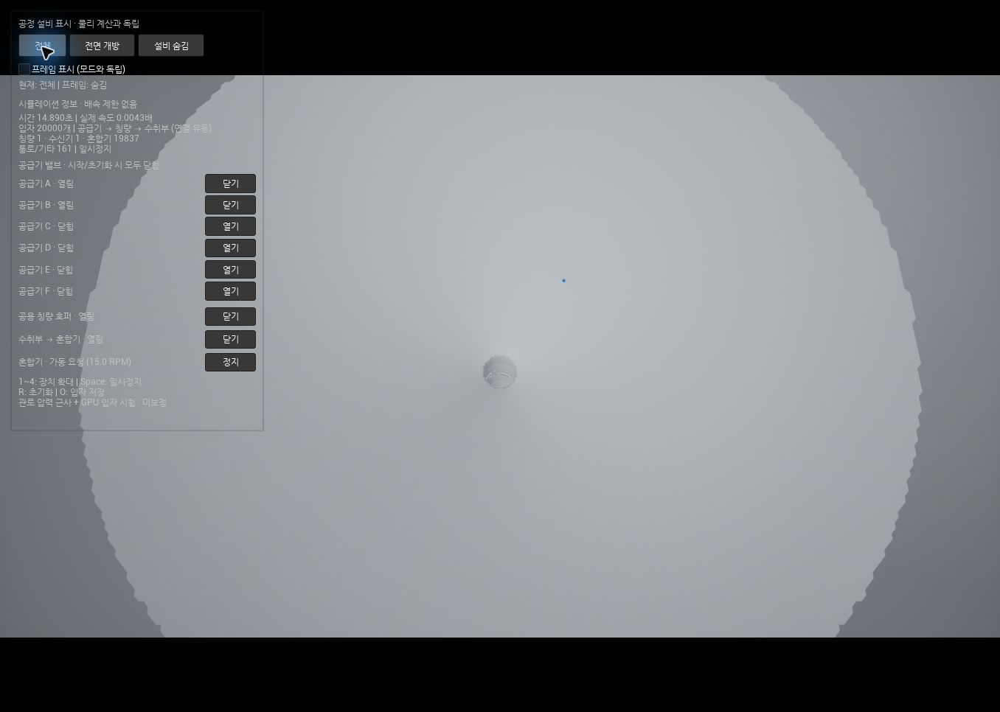

### 그림 11. 최종 에디터 상태

동일 PIE를 유지하고 툴바 일시정지까지 적용했다. 시간 14.89008초. 전면 개방·프레임 숨김·전체 공정 시점. 재실행하지 않았다.

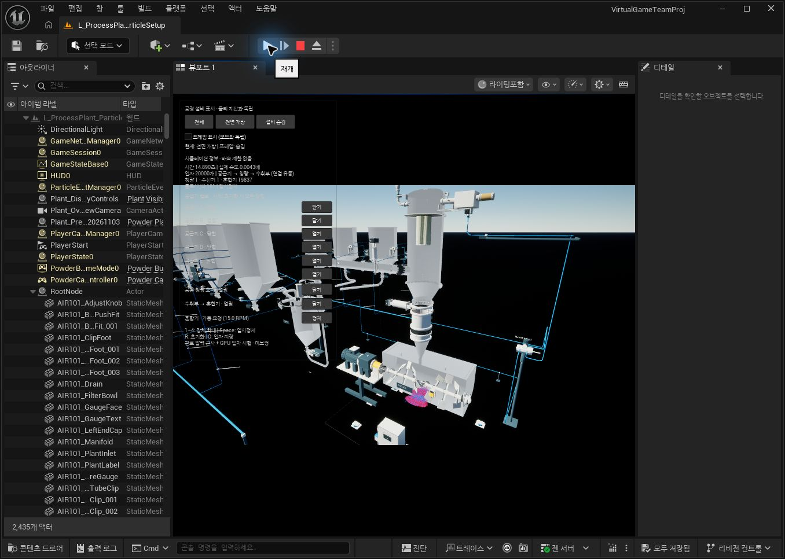

